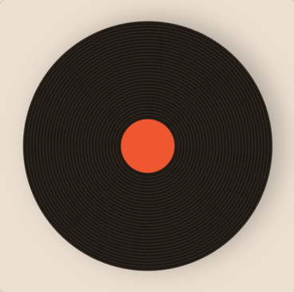

  
  <h1>Le Bac à Vinyles eshop website</h1>
  
  

    A vinyl seller wants a website for his shop. He wants his catalog to be displayed with all the differents products stored in a database.
    Users can register, log in and add products to their online shopping cart.
    Admin has access to a dashboard and can add some more products.
  

<!-- Table of Contents -->
# :notebook_with_decorative_cover: Table of Contents

- [About the Project](#star2-about-the-project)
- [Tech Stack](#space_invader-tech-stack)
- [Features](#dart-features)
- [Missions](#compass-roadmap)
  

<!-- About the Project -->
## :star2: About the Project

All pages are already implemented in static HTML/CSS.
No framework, no IA.

 
  

<!-- TechStack -->
## :space_invader: Tech Stack

PHP

<ul>
  <li><a href="https://dannyvankooten.github.io/AltoRouter/">Altorouter</a></li>
  <li>POST, GET methods</li>
  <li>$_SESSION management</li>
  <li>Reactive pages that fits with database</li>
</ul>

Javascript

<ul>
  <li>Responsiveness without reloading</li>
  <li>Data manipulations</li>
  <li>Event listeners</li>
</ul>

<!-- Features -->
## :dart: Features

- display vinyl records from the `data/vinyles.php` file;
- filter the catalog;
- add records to the cart;
- create an account, log in with data from `data/utilisateurs.php` file;
- provide an admin panel for the administrator.

<!-- Roadmap -->
## :compass: Roadmap

* [x] Mission 1 :
Setting up all the pages and routes with Altorouter --> `index.php`
* [X] Mission 2 :
Dynamic view of the landing page --> `/views/accueil.php`
* [X] Mission 3 :
Catalog, filters and research function --> `/views/catalogue.php`
* [X] Mission 4 :
Product page for each product stored in `/data/vinyles.php` --> `/views/vinyle.php`   
* [X] Mission 5 :
Javascript for command quantity management --> `/views/vinyle.php`
* [X] Mission 6 :
Register form, errors and functions --> `/views/inscription.php`
* [X] Mission 7 :
Log in form, log out, session and responsive navbar --> `/views/connexion.php`
* [ ] Mission 8 :
Shopping cart view and functions --> `/views/panier.php`
* [ ] Mission 9 :
Admin dashboard and adding new products --> `views/admin.php`

  
Bonus missions :

  <ul>
    <li> * [ ] Removing product from shopping cart</li>
    <li> * [ ] Control over stock in shopping cart</li>
    <li> * [ ] Product removal from catalog</li>
  </ul>

